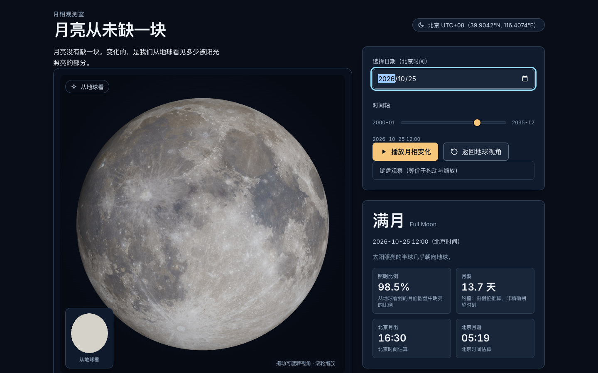

# 月相观测室 · Moon Phase Observatory

> **月亮没有缺一块。变化的，是我们从地球看见多少被阳光照亮的部分。**

一个用**真实 3D 月球**讲清月相的网页：拖动日期就能看到那一天真实的月相形态、被照亮的比例、月龄与北京的月出月落时间。



## 这个页面想讲清什么

月球被太阳照亮的**永远只有一半**。地面看到的"形状"，只是这半边里有多少朝着我们。

- **月牙 / 半月 / 满月的由来** —— 月球绕地球运行，我们正对着它看到的那块亮面时多时少。
- **为什么上下弦月的明暗界线是一条直线** —— 亮暗分界在月面是一个大圆，弦月时我们几乎从侧面看它，投影到月盘上就成了穿过中心的一条直线。
- **为什么总看到同一面** —— 月球自转周期与公转周期相同（潮汐锁定），朝向地球的一面持续朝向我们。

## 运行

```bash
npm ci
npm run dev          # 开发服务器
npm run build        # 生产构建 → dist/
npm run preview      # 预览构建产物
npm test             # 单元测试（node --test）
npm run test:e2e     # 浏览器端到端测试（Playwright）
npm run check:dist   # 构建产物零外部请求门禁
npm run assets:moon  # 构建期重新拉取 NASA 月面贴图（需要联网）
```

## 技术要点

| 项 | 选择 |
|---|---|
| 3D | `three@0.186.1`（WebGL + OrbitControls + 方向光） |
| 月相计算 | `suncalc@2.1.1`（纯本地计算，零网络请求） |
| 构建 | `vite@8.3.5`，`base: "./"` 可部署到任意静态子路径 |
| 字体 | Inter + Noto Sans SC，按页面实际用字子集化后自托管 |
| 月面贴图 | NASA SVS「CGI Moon Kit」（公开领域），构建期下载并打包 |

### 受光模型

月面光照由**月相角**直接决定，不是贴图切换：

```
i = acos(2·fraction − 1)          相角（满月 0°、上下弦 90°、新月 180°）
lightDir = (waxing ? +1 : −1)·sin i, 0, cos i
```

相机固定在 +Z 观察，因此满月全亮、朔全暗、上弦右亮、下弦左亮。缩略图与 3D 球共用同一套球面 UV 与光照判定，保证两者一致。

> 这是**北朝上的标准化教学示意**，不是北京当地真实天空姿态，也不含天平动与真实黄道倾角。

## 目录

```
src/astro/     日历、���相、月球快照、月出月落（纯函数，可被 Node 直接 import）
src/state/     单一状态源（store + reducer）
src/scene/     Three.js 场景、材质、2D 降级
src/ui/        DOM 渲染、图标、轨道示意图、地球视角缩图
src/assets/    程序化月面贴图（NASA 贴图不可用时的兜底）
src/styles/    设计令牌（唯一真源）+ 基础/布局/组件样式
scripts/       素材获取、字体子集化、产物零外网检查
tests/         单元测试与 Playwright 端到端测试
reports/       执行报告与证据
```

## 数据来源与授权

- 月面彩色图与高程图：NASA Scientific Visualization Studio「CGI Moon Kit」
  <https://svs.gsfc.nasa.gov/4720/> —— NASA 素材（含 3D 贴图条款）一般不受版权保护，页面已署名。
  校验值见 `public/assets/moon/MANIFEST.txt`。
- 月相算法：SunCalc（Volodymyr Agafonkin，MIT），基于 Jean Meeus《Astronomical Algorithms》。
- 字体：Inter 与 Noto Sans SC，均为 SIL Open Font License 1.1，许可证随包分发。

## 已知限制

- 朔望时刻与真实高精度星历可相差数十分钟（低精度星历的固有限制）。
- 升落时间是北京时间/北京地区的**估算**，不是城市级实时星历服务。
- 不模拟月表自阴影、地照、天平动与真实月面轴位角。
